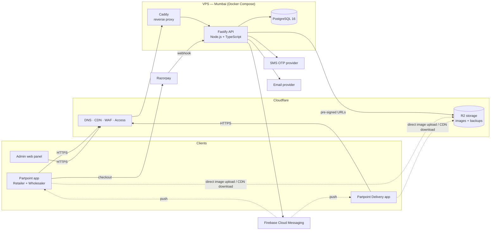

# Partpoint

**A B2B spare-parts e-commerce platform connecting wholesalers, retailers, and delivery partners. An admin manages the whole network.**

Retailers browse and order parts from wholesalers and pay online. Delivery partners pick up from the wholesaler and deliver to the retailer. The admin approves users, manages the catalog, assigns deliveries, and tracks commissions and reports.

---

## Table of Contents

- [Applications](#applications)
- [Scope](#scope)
- [Application Flow](#application-flow)
- [Architecture](#architecture)
- [Tech Stack](#tech-stack)
- [Low-Latency Design](#low-latency-design)
- [Security](#security)
- [Google Play Compliance](#google-play-compliance)
- [Repository Structure](#repository-structure)
- [Engineering Principles](#engineering-principles)
- [Getting Started](#getting-started)
- [Configuration & Secrets](#configuration--secrets)
- [Branching & CI/CD](#branching--cicd)
- [Delivery Plan](#delivery-plan)
- [Cost up to Play Store Launch](#cost-up-to-play-store-launch)
- [Open Decisions](#open-decisions)

---

## Applications

Partpoint has **three client applications and one backend**. The two Android apps are built from **one Kotlin codebase** with shared modules.

| # | App | Users | Platform | Distribution |
|---|---|---|---|---|
| 1 | **Partpoint** | Retailers + Wholesalers | Android | Google Play Store |
| 2 | **Partpoint Delivery** | Delivery partners | Android | Google Play Store |
| 3 | **Partpoint Admin** | Admin / operator | Web | `admin.<domain>`, behind Cloudflare Access |
| — | **Backend API** | Serves all of the above | Server | India-region VPS |

### Why a separate delivery app (the Zomato / Swiggy model)

| Concern | Benefit of a separate app |
|---|---|
| Play Store review | Only the Delivery app requests location, so the permission is clearly justified as a core feature. This is the main way we avoid permission-related rejections. |
| Data safety | Each app declares only the data it collects. Retailers never see "collects precise location". |
| Security | Delivery code and endpoints are not present on retailer devices, so a smaller attack surface. |
| UX & releases | Each app has focused onboarding and a smaller size, and the two release independently. |

Retailer and Wholesaler share one app. Both are business users, both work with the same catalog and orders, and neither needs a sensitive permission.

## Scope

### Version 1 (current scope)

| Module | Functionality |
|---|---|
| **Admin (web)** | Dashboard (sales, orders, users, revenue); approve or block wholesalers, retailers and delivery partners; category, brand, product and stock management; order management and delivery assignment; pricing, discounts, coupons, banners; payments, commission, reports, CSV export; push notifications; review moderation |
| **Wholesaler** | Registration and profile, with admin approval; product management with variants, bulk price slabs, stock and images; process incoming orders; order history, invoices, payments and sales reports |
| **Retailer** | Registration/login, profile, multiple addresses; browse with search, filters and categories; cart, wishlist, coupons, checkout, online payment; order tracking and history; reorder, invoices, ratings and reviews, notifications |
| **Delivery partner** | Login, profile, availability toggle; view and accept assigned deliveries; pickup and delivery status updates with addresses and navigation; delivery OTP confirmation; history and earnings; notifications |
| **Common** | OTP / email login, role-based access, forgot password, in-app account deletion, push notifications, GST invoices (PDF) |

### Phase 2 (not in v1, requires a separate change request)
- **Udhaar (credit) ledger:** an append-only ledger of outstanding dues, with a credit limit per shop
- **Doorstep defect / return flow (RMA),** with GPS-verified line-item adjustments
- **Geofenced catalog:** retailers see only wholesalers within a set radius
- **Offline-first catalog** (Room DB + background sync)
- **Continuous live GPS tracking** of delivery partners
- **Automated wholesaler payouts** (Razorpay Route)

## Application Flow

### 1. Registration & approval
```
User signs up (phone OTP or email + password) → status PENDING
  → Admin reviews in the web panel → APPROVED / BLOCKED
  → Push notification: "Account approved" → full access
```

### 2. Catalog
```
Wholesaler adds a product (category, brand, variants, bulk price slabs, stock, photos)
  → Photos are compressed to WebP on the device → uploaded directly to R2 via a pre-signed URL
  → Product goes live (admin can hide or block it)
Admin manages categories, brands, banners and coupons
```

### 3. Order lifecycle
```
RETAILER    Browse → Cart (multi-wholesaler) → Coupon → Checkout → Pay (Razorpay)
                │
BACKEND     Razorpay webhook verified → stock reserved in a DB transaction
            → cart split into one sub-order per wholesaler → GST invoice PDF generated
                │
WHOLESALER  Push "New order" → Accept → Packed
                │
ADMIN       Assigns an available delivery partner
                │
DELIVERY    Push "New delivery" → Accept → Picked up → Out for delivery
            → Delivered (retailer shares the delivery OTP)
                │
RETAILER    Live status updates → Rate & review → Reorder
                │
BACKEND     Commission computed → wholesaler payable recorded → delivery earnings recorded
```

> **Current build:** online payment is deferred (see [Open Decisions](#open-decisions)). "Checkout → Pay" is
> currently "Place order": stock is taken and the orders are created immediately; payment is settled offline.

### 4. Money flow
```
Retailer pays → Platform's Razorpay account → Platform commission retained
→ Wholesaler payout (tracked in the admin panel, settled manually in v1)
→ Delivery earnings tracked per delivery
```

## Architecture



- **Request path:** App → Cloudflare edge (TLS, WAF, DDoS protection) → Caddy → Fastify → PostgreSQL.
- **Images** never pass through the VPS. They are uploaded and downloaded directly via R2 and the Cloudflare CDN.
- **The admin panel** is reachable only through Cloudflare Access (approved emails only).

## Tech Stack

| Layer | Technology |
|---|---|
| Android apps | Kotlin, Jetpack Compose, Navigation Compose, Hilt, Retrofit + OkHttp, Coil, kotlinx.serialization, FCM, Play Integrity API, Baseline Profiles |
| Admin panel | React + TypeScript, Vite, Refine (or react-admin) |
| Backend | Node.js 22 LTS, TypeScript 5, Fastify 5, Zod |
| Database | PostgreSQL 16 + Drizzle ORM (full-text / `pg_trgm` search) |
| Storage / CDN | Cloudflare R2 + Cloudflare CDN |
| Payments | Razorpay (Orders API + webhooks) |
| Messaging | FCM (push), Fast2SMS / MSG91 (OTP), Brevo / Resend (email) |
| Invoices | PDFKit (server-side GST invoices) |
| Hosting | One VPS in the India region (AWS Lightsail Mumbai) with Docker Compose: `caddy`, `api`, `postgres` |
| Edge & security | Cloudflare DNS, WAF, rate limiting, Access (admin) |
| CI/CD | GitHub Actions |
| Ops | UptimeRobot (`/health`), daily `pg_dump` → R2, Dependabot |

## Low-Latency Design

The goal is **instant perceived response**, so no tap waits on the network when it doesn't have to.

| Layer | Technique | Result |
|---|---|---|
| **On device** | Optimistic UI for cart, wishlist and quantity; stale-while-revalidate (OkHttp disk cache + ETags); prefetching the next page and images; Baseline Profiles + R8 | Instant (~0–50 ms) |
| **Network** | Server in Mumbai (~20–40 ms RTT within India); images from Cloudflare's Indian edge in WebP (thumbnails ~20–30 KB); one shared HTTP/2 connection; Brotli/gzip | Short round trips |
| **Server** | Correct indexes, cursor pagination, lean payloads, in-memory cache for categories/banners/settings, pre-aggregated dashboard stats, slow work (PDFs, pushes) done after the response | API p95 < 200 ms |
| **Real-time** | FCM push for status changes (no polling); Server-Sent Events while the tracking screen is open | ~1 s status updates |

## Security

### Backend
- **Object-level authorization on every endpoint.** Retailers see only their own orders, wholesalers only theirs, delivery partners only their assigned deliveries. This is enforced by one shared guard and covered by tests.
- **Server-side pricing.** The client never sends totals. Razorpay payment and webhook signatures are verified, webhooks are processed idempotently, and amounts are reconciled.
- **Auth.**
  - OTPs: 6 digits, hashed, 5-minute expiry, at most 5 attempts, single use, rate-limited per phone and per IP.
  - Passwords: Argon2id.
  - Sessions: 15-minute access JWTs plus rotating, device-bound refresh tokens. Blocking a user revokes access instantly.
- **Input validation** on every route (Zod). All queries are parameterized through Drizzle.
- **Uploads.** Pre-signed URLs restrict content type and size and expire in minutes. EXIF/GPS data is stripped.
- **Admin.** Cloudflare Access gate, TOTP 2FA, audit log of admin actions.
- **Infrastructure.**
  - SSH keys only, no root login.
  - The firewall allows 80/443 only from Cloudflare IP ranges.
  - Postgres is never exposed to the internet.
  - Unattended security upgrades; encrypted backups.
- **Privacy (India's DPDP Act).**
  - Consent at signup, data minimization, working account deletion.
  - Delivery partners see a retailer's phone number and address only during an active delivery.
- **Secrets.** Secrets live only in GitHub Actions Secrets and the server environment, never in the repo or the APK.

### Android
- HTTPS only (cleartext traffic disabled through the network security config).
- Tokens encrypted with keys held in the Android Keystore; tokens excluded from device backup.
- R8 obfuscation; no debug logging in release builds.
- Play Integrity API check at login and checkout.
- `FLAG_SECURE` on OTP and payment screens.

## Google Play Compliance

The goal is approval on the first submission. Every item below is part of the definition of done.

### Account & build
- [ ] **Organization developer account** in the client's business name (requires a free D-U-N-S number). This avoids the 14-day, 12-tester closed-testing requirement that applies to new personal accounts.
- [ ] Android App Bundle (AAB) with Play App Signing.
- [ ] Target the **latest required API level** (verify in Play Console at submission time).
- [ ] 16 KB memory page-size compatible (check the App Bundle Explorer warnings).

### Permissions
- [ ] **No `READ_SMS`.** OTP auto-fill uses the SMS Retriever / User Consent API.
- [ ] **No `READ_MEDIA_IMAGES`.** Product photos are chosen through the Android Photo Picker.
- [ ] Location **only in the Delivery app**: while-in-use permission plus a `location`-type foreground service during an active delivery, with a prominent in-app disclosure before the request.
- [ ] **No `ACCESS_BACKGROUND_LOCATION`.**
- [ ] Foreground service declaration and demo video submitted (Delivery app).
- [ ] Notification permission requested in context, not at first launch.

### Play Console declarations
- [ ] **App access:** working demo accounts for **every role**, using test numbers with a fixed OTP, pre-approved.
- [ ] **Account deletion:** an in-app option plus a public web URL.
- [ ] **Privacy policy:** hosted on our domain and linked in the app; matches the Data safety form.
- [ ] **Data safety form:** accurate for each app (location declared only for Delivery).
- [ ] **User-generated content:** "Report review" in the app and moderation in the admin panel.
- [ ] Target audience 18+; content rating questionnaire; ads declaration (none); financial features declaration (none in v1).
- [ ] Store listing uses real screenshots and an accurate description, with no third-party brand names or keyword stuffing.
- [ ] Production backend and demo catalog live and stable during review.

> **Phase 2 note:** If Udhaar is added, it must be presented as *outstanding dues / account statement*, with no interest and no lending terms, so that it does not fall under the personal loan app policy for India.

## Repository Structure

```
Partpoint/
├── .github/workflows/
│   ├── backend.yml           # typecheck, lint, test → deploy on main
│   ├── admin.yml             # build → deploy on main
│   └── android.yml           # unit tests → signed AABs on main
│
├── android/                  # One Gradle project, two apps
│   ├── app-partpoint/        # Retailer + Wholesaler app
│   ├── app-delivery/         # Delivery partner app (only module with location permission)
│   ├── core/
│   │   ├── network/          # Retrofit, OkHttp, auth interceptor, Play Integrity
│   │   ├── data/             # Repositories, models, caching
│   │   ├── auth/             # OTP / login / session handling
│   │   └── ui/               # Shared Compose design system
│   └── gradle/libs.versions.toml
│
├── admin/                    # React admin panel
│
├── backend/
│   ├── src/
│   │   ├── index.ts          # Fastify bootstrap
│   │   ├── db/               # Drizzle schema + migrations
│   │   ├── modules/          # auth, users, catalog, cart, orders, payments,
│   │   │                     # delivery, coupons, reviews, reports, notifications
│   │   ├── plugins/          # auth guard, rate limit, error handling
│   │   └── lib/              # r2, fcm, razorpay, sms, mail, pdf
│   ├── docker-compose.yml
│   ├── Caddyfile
│   ├── Dockerfile
│   └── drizzle.config.ts
│
├── docs/                     # Privacy policy, account deletion page, API notes
├── CHANGELOG.md
└── README.md
```

## Engineering Principles

1. **Money is integers.** All amounts are stored as `BIGINT` paise.
2. **The server is the source of truth** for prices, totals, stock, and permissions.
3. **Writes are idempotent.** Orders and payments carry an idempotency key, and Razorpay webhooks are deduplicated.
4. **Stock is locked transactionally.** `SELECT … FOR UPDATE` runs inside the order transaction, so stock is never oversold.
5. **Least privilege everywhere:** app permissions, API roles, database access, admin reach.
6. **Heavy work stays off the request path** (PDFs, bulk pushes, reports).
7. **No secrets in code or in APKs.**

## Getting Started

> These instructions will be expanded as each part is scaffolded.

### Prerequisites
- Git, Docker Desktop
- **Backend / Admin:** Node.js 22 LTS, pnpm
- **Android:** Android Studio (latest stable), JDK 17

### Backend
```bash
cd backend
cp .env.example .env           # if a local Postgres already uses 5432, set POSTGRES_HOST_PORT and DATABASE_URL to 5433
pnpm install
docker compose up -d
pnpm db:migrate
curl http://localhost/health   # → { "status": "ok", "postgres": "connected" }

# First admin account (admins cannot self-register)
ADMIN_EMAIL=you@example.in ADMIN_PASSWORD='at-least-12-chars' pnpm db:seed:admin

pnpm test                      # integration tests use a separate <db>_test database, created automatically
```

In development, no SMS or email is sent: OTP codes appear in the API log (`docker compose logs api`, look for `devCode`).

Production uses only the base compose file, which never publishes the Postgres port:
`docker compose -f docker-compose.yml up -d`.

### Admin panel
```bash
cd admin
pnpm install
pnpm dev
```

### Android
Open `/android` in Android Studio. Run `app-partpoint` or `app-delivery`.

## Configuration & Secrets

These are stored in **GitHub Actions Secrets** and in local `.env` files. They are never committed.

| Group | Keys |
|---|---|
| Deploy | `VPS_HOST`, `VPS_USER`, `VPS_SSH_KEY` |
| Data / auth | `DATABASE_URL`, `JWT_SECRET`, `REFRESH_TOKEN_SECRET`, `OTP_SECRET` (each ≥ 32 chars and different) |
| Play review | `DEMO_PHONES` (comma-separated), `DEMO_OTP` (fixed 6-digit code; these numbers are never sent an SMS) |
| Storage | `R2_ACCOUNT_ID`, `R2_ACCESS_KEY_ID`, `R2_SECRET_ACCESS_KEY`, `R2_BUCKET_NAME`, `R2_PUBLIC_URL` (CDN base for images) |
| Payments | `RAZORPAY_KEY_ID`, `RAZORPAY_KEY_SECRET`, `RAZORPAY_WEBHOOK_SECRET` |
| Messaging | `SMS_API_KEY`, `MAIL_API_KEY`, `MAIL_FROM`, `FIREBASE_SERVICE_ACCOUNT` |
| Android signing | Upload keystore (base64), `KEYSTORE_PASSWORD`, `KEY_ALIAS`, `KEY_PASSWORD`, `PLAY_SERVICE_ACCOUNT_JSON` |

> ⚠️ Keep a backup of the Android upload keystore in a password manager. With Play App Signing, a lost upload key can be reset, but only after a support process that takes several days.

## Branching & CI/CD

| Branch | Purpose |
|---|---|
| `main` | Production. Protected: CI must pass before merging. |
| `develop` | Integration / staging |
| `feature/<name>` | Branched from `develop` and merged back via PR |

- **Every push:** backend typecheck, lint, and tests; admin build; Android unit tests. Path filters ensure only the affected part runs.
- **Backend image:** built in GitHub Actions and boot-tested (migrations on an empty database, then `/health`) on every push and PR. Pushes to `main` and `develop` publish it to GHCR as `ghcr.io/<owner>/partpoint-api` with tags `sha-<commit>` plus `latest` / `develop`. The server never builds images.
- **Merge to `main`:**
  - Backend deploys to the VPS: the server pulls the `sha-<commit>` image, runs migrations, and restarts only the `api` container, then checks `/health`. The image is pinned in the server's `.env` (`API_IMAGE`). To roll back, re-run the deploy job of an earlier commit.
  - The admin panel deploys.
  - Signed AABs for both apps are uploaded to the Play internal testing track.
- Android `versionCode` is derived from the git commit count. CI checks out the full history (`fetch-depth: 0`) so the count is correct.

## Delivery Plan

The timeline is 15 working days from receiving the client's content (logo, categories, product data, banners).

| Days | Work |
|---|---|
| 1–2 | Repo, DB schema, auth (OTP, email, reset, approval), VPS + Cloudflare, CI |
| 3–5 | Catalog (categories, brands, products, variants, images, stock, bulk pricing) + admin CRUD |
| 6–8 | Cart, wishlist, addresses, checkout, Razorpay, orders, invoices |
| 9–10 | Delivery app: assignment, status flow, delivery OTP, earnings; push notifications |
| 11–12 | Coupons, banners, reviews and moderation, commission, dashboard, reports |
| 13–14 | QA, security pass, Play compliance items, store listings, privacy policy |
| 15 | Production AABs submitted to Play review |

**Start immediately (client side):** D-U-N-S number and Play Organization account, Razorpay KYC, SMS sender/DLT registration, domain purchase.

## Cost up to Play Store Launch

These are estimates as of Nov 2026, at about ₹88 per US$1, and include 18% GST where it applies. Verify current prices before purchasing.

### One-time / pre-launch costs

| Item | Cost (₹) | Notes |
|---|---|---|
| Google Play Developer account | ~2,200 | US$25 one-time. Covers both apps. |
| D-U-N-S number | 0 | Free via Dun & Bradstreet (needed for an Organization account) |
| Domain (.in / .com) | ~600–1,200 | First year |
| VPS, first month (Lightsail Mumbai, 2 GB) | ~1,250 | US$12/mo + GST. Used as the review/production server. |
| SMS OTP credits (testing + launch) | ~500 | Fast2SMS ~₹0.15–0.25 per SMS |
| DLT registration (if the SMS route requires it) | 0–5,900 | One-time, via an operator DLT portal |
| Razorpay account | 0 | No setup fee; test mode is free |
| Cloudflare (DNS, CDN, WAF, Access), R2, FCM, Play Integrity, GitHub, UptimeRobot, email (free tier) | 0 | All within free tiers at this scale |
| **Total to launch** | **~₹4,750 – ₹11,050** | Lower figure: no DLT. Upper figure: DLT needed and .com domain. |

### Running costs after launch

| Item | Monthly (₹) | Yearly (₹) |
|---|---|---|
| VPS (Lightsail Mumbai, 2 GB) | ~1,250 | ~15,000 |
| SMS OTP (~500–1,000 OTPs/month) | ~100–250 | ~1,200–3,000 |
| Domain renewal | ~75 | ~900 |
| Everything else | 0 | 0 |
| **Total** | **~₹1,425 – ₹1,575** | **~₹17,100 – ₹18,900** |

- **Cheaper option:** Lightsail 1 GB (US$7/mo ≈ ₹730/mo with GST, ≈ ₹8,700/yr) is enough at launch with swap configured; upgrade later in place.
- **Transaction fees:** Razorpay charges about 2% + GST per successful payment. This is deducted from each payment, not billed separately.

## Open Decisions

| Decision | Current assumption |
|---|---|
| Udhaar / RMA / geofence in v1? | No. Listed as Phase 2. |
| Online payment (Razorpay) | **Deferred.** Orders are placed straight from the cart and payment is settled offline for now. The checkout record that groups a retailer's orders is kept so Razorpay can be added later without schema rework. |
| Android language | Kotlin + Jetpack Compose |
| Server | AWS Lightsail Mumbai (2 GB) |
| SMS provider | Fast2SMS (confirm whether its OTP route needs DLT) |
| Play account type | Organization (client-owned) |

---

See [CHANGELOG.md](CHANGELOG.md) for version history.
