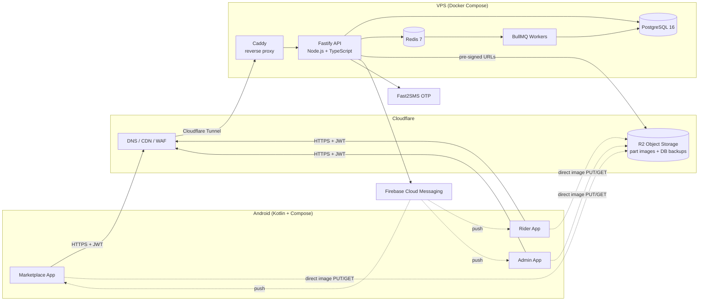

# Partpoint

**A B2B spare-parts marketplace for hyperlocal ordering, delivery, and credit (Udhaar) management.**

Partpoint connects **wholesalers** and **retailers** within a geofenced zone (~3 km). Riders deliver orders to the doorstep, and an admin runs the network. The system is built for Indian market conditions: patchy 4G, cash and credit (Udhaar) payments, and defects reported at the doorstep.

---

## Table of Contents

- [Applications](#applications)
- [Core Features](#core-features)
- [Architecture](#architecture)
- [Tech Stack](#tech-stack)
- [Repository Structure](#repository-structure)
- [Key Engineering Principles](#key-engineering-principles)
- [Getting Started](#getting-started)
- [Configuration & Secrets](#configuration--secrets)
- [Branching & CI/CD](#branching--cicd)
- [Development Roadmap](#development-roadmap)
- [Operations](#operations)

---

## Applications

One Android codebase produces **three separate apps** through Gradle Product Flavors. One Node.js backend serves all three.

| App | Users | Distribution | Permissions |
|---|---|---|---|
| **Marketplace** | Retailers & Wholesalers | Google Play Store | No location permission |
| **Rider** | Delivery riders | Google Play Store | `ACCESS_FINE_LOCATION` (while in use only) |
| **Admin** | Business owner / operator | Firebase App Distribution (no Play Store) | No public signup |

Each flavor declares only the permissions it needs. This keeps Play Store review simple and avoids permission-related rejections.

## Core Features

- **Phone + OTP login.** Accounts are pre-provisioned by the Admin, so there is no public signup. The backend issues a JWT bound to the device's Android ID.
- **Geofenced catalog.** Retailers see only the wholesalers within ~3 km. The catalog is cached on the device, so browsing works offline.
- **Part listings with images.** Wholesalers upload part photos, which are compressed to WebP (≤70 KB) on the device and uploaded straight to object storage. The Admin approves each listing.
- **Ordering.** Ordering is idempotent and safe on flaky networks. Stock is locked in the database at checkout, so overselling can't happen.
- **Rider dispatch.** Riders receive a push notification for each new order. The first rider to accept claims it. Delivery is confirmed with an OTP.
- **Doorstep RMA.** At the door (GPS-verified within 150 m), the rider reports defects line by line. The amount due is recalculated before collection.
- **Udhaar (credit) ledger.** The credit ledger is append-only, with a credit limit for each shop that the Admin sets. Balance = sum of ledger entries.
- **Admin tools.** The Admin creates users, places shop GPS pins on an OpenStreetMap map, sets credit limits, and generates daily CSV reports.

## Architecture



**How a request flows:** App → Cloudflare edge (DDoS, WAF) → Cloudflare Tunnel (the VPS exposes no public web ports) → Caddy → Fastify → PostgreSQL / Redis.

**Images never pass through the VPS.** The backend issues short-lived (15-minute) pre-signed R2 URLs, and the apps upload and download images directly.

## Tech Stack

### Android (`/android`)
| Concern | Technology |
|---|---|
| Language / UI | Kotlin, Jetpack Compose, Navigation Compose |
| State | ViewModel + StateFlow |
| DI | Hilt |
| Networking | Retrofit 2 + OkHttp 4 |
| Local DB / offline cache | Room (SQLite) |
| Background work | WorkManager (catalog sync, order retry) |
| Images | Coil |
| Push | Firebase Cloud Messaging |
| Maps | OpenStreetMap tiles (no Google Maps SDK) |
| Min SDK | API 24 (Android 7.0) |
| Dependency versions | Gradle version catalog (`libs.versions.toml`) |

### Backend (`/backend`)
| Concern | Technology |
|---|---|
| Runtime / language | Node.js (LTS) + TypeScript 5 |
| Framework | Fastify (`@fastify/jwt`, `@fastify/rate-limit`, CORS) |
| Database | PostgreSQL 16 + Drizzle ORM |
| Cache / queue broker | Redis 7 (AOF persistence) |
| Background jobs | BullMQ (reports, bulk notifications, cleanup) |
| Object storage | Cloudflare R2 (via `@aws-sdk/client-s3`) |
| Validation | JSON Schema / Zod |
| Package manager | pnpm |
| Testing | Jest |

### Infrastructure
| Concern | Technology |
|---|---|
| Hosting | Single VPS running Docker Compose (`caddy`, `api`, `postgres`, `redis`) |
| Network / security | Cloudflare DNS, CDN, WAF, Tunnel |
| Reverse proxy | Caddy v2 |
| CI/CD | GitHub Actions |
| Admin APK distribution | Firebase App Distribution |
| SMS OTP | Fast2SMS |
| Backups | Daily `pg_dump` + zstd → R2, 7-day retention |
| Monitoring | UptimeRobot on `/health` |

## Repository Structure

> The structure below is the target layout. Folders get created as each phase of the roadmap starts.

```
Partpoint/
├── .github/workflows/
│   ├── backend.yml            # tsc, eslint, jest → deploy on main
│   └── android.yml            # unit tests (all flavors) → release builds on main
│
├── android/                   # Single Android Studio project
│   ├── app/src/
│   │   ├── main/              # Shared code for all 3 flavors
│   │   │   └── kotlin/.../
│   │   │       ├── data/      # Retrofit, Room, repositories
│   │   │       ├── domain/    # Use cases, models
│   │   │       └── ui/shared/ # Shared Compose components
│   │   ├── marketplace/       # Retailer + Wholesaler app (own AndroidManifest.xml)
│   │   ├── rider/             # Rider app (location permission)
│   │   └── admin/             # Admin app
│   ├── app/build.gradle.kts   # Product flavors + signing config
│   └── gradle/libs.versions.toml
│
├── backend/
│   ├── src/
│   │   ├── index.ts           # Fastify bootstrap
│   │   ├── db/                # schema.ts (Drizzle tables), connection pool
│   │   ├── routes/            # auth, catalog, orders, ledger, riders, upload
│   │   ├── workers/           # BullMQ workers (reports)
│   │   └── lib/               # redis, r2, fcm clients
│   ├── docker-compose.yml
│   ├── Caddyfile
│   ├── Dockerfile             # Multi-stage build
│   ├── drizzle.config.ts
│   └── package.json
│
├── CHANGELOG.md
└── README.md
```

Android and backend are **sibling folders**. CI workflows use path filters (`android/**`, `backend/**`), so a change on one side never triggers the other side's pipeline.

### Database tables (initial)
`users`, `shops`, `master_parts`, `inventory`, `orders`, `order_items`, `ledger_entries`, `idempotency_keys`

## Key Engineering Principles

1. **Money is integers.** All currency is stored as `BIGINT` paise, never floats.
2. **Money rows are never updated.** The Udhaar ledger is append-only, and balances are computed as `SUM(entries)`.
3. **Every write is idempotent.** Clients send an `X-Idempotency-Key` (UUID) with each request. The backend checks Redis first (fast path), then Postgres (durable path). Retries are safe, and a duplicate returns `409`.
4. **Stock is locked transactionally.** Order placement uses `SELECT … FOR UPDATE` inside one transaction (ACID).
5. **The app works offline first.** Room caches the catalog and syncs only the changes (deltas). Failed orders are queued in WorkManager and retried once connectivity returns.
6. **SMS is guarded before it's sent.** An OTP SMS goes out only if the phone belongs to a provisioned user **and** the Redis rate limit (≤3 per 60 s) hasn't been hit.
7. **No secrets in code.** All credentials live in GitHub Actions Secrets or in local `.env` files, which are never committed.
8. **Heavy work goes off the request path.** Reports and bulk pushes run on BullMQ workers, so API responses stay under 200 ms.

## Getting Started

> Setup instructions will be expanded as the scaffold is built. These are the prerequisites.

### Prerequisites
- Git
- **Backend:** Node.js (current LTS), pnpm, Docker Desktop
- **Android:** Android Studio (latest stable), JDK 17
- A Bruno or Postman client for API testing

### Run the backend locally (once scaffolded)
```bash
cd backend
cp .env.example .env        # fill in local values
pnpm install
docker compose up -d        # caddy, api, postgres, redis
pnpm drizzle-kit push       # apply schema
curl http://localhost/health
# → { "status": "ok", "postgres": "connected", "redis": "connected" }
```

### Run the Android apps (once scaffolded)
Open `/android` in Android Studio, select a build variant (`marketplaceDebug`, `riderDebug`, or `adminDebug`), and run.

```bash
./gradlew assembleMarketplaceDebug assembleRiderDebug assembleAdminDebug
```

## Configuration & Secrets

These values are stored as **GitHub Actions Secrets** (and in a local `.env` for development). They must never be committed.

| Group | Keys |
|---|---|
| Server / deploy | `VPS_HOST`, `VPS_USER`, `VPS_SSH_KEY` |
| Data | `DATABASE_URL`, `REDIS_URL` |
| Auth | `JWT_SECRET` |
| Storage (R2) | `R2_ACCOUNT_ID`, `R2_ACCESS_KEY_ID`, `R2_SECRET_ACCESS_KEY`, `R2_BUCKET_NAME` |
| SMS | `FAST2SMS_API_KEY` |
| Firebase | `FIREBASE_TOKEN`, `google-services.json` (one per flavor) |
| Android signing | `PLAY_STORE_KEY_JSON`, keystore (base64), `KEYSTORE_PASSWORD`, `KEY_ALIAS`, `KEY_PASSWORD` |

> ⚠️ **Android release keystore:** if this file is lost, the app can never be updated on the Play Store. Keep a copy in a password manager in addition to GitHub Secrets.

## Branching & CI/CD

| Branch | Purpose |
|---|---|
| `main` | Production. Protected, so merging requires CI to pass. |
| `develop` | Staging / integration. |
| `feature/<name>` | Feature work, branched from `develop` and merged back via PR. |

**On push to any branch:**
- Backend: `tsc --noEmit` → ESLint → Jest
- Android: unit tests for all three flavors

**On merge to `main`:**
- Backend: the workflow SSHes into the VPS, pulls the latest code and rebuilds only the `api` container (Postgres and Redis keep running).
- Android: signed release builds. Marketplace + Rider go to the Play Store internal track, and Admin goes to Firebase App Distribution.
- Version code is computed automatically from `git rev-list --count HEAD`.

## Development Roadmap

| Phase | Scope | Gate |
|---|---|---|
| **0. Accounts & infra bootstrap** | GitHub, Firebase, Play Console, Cloudflare + domain, R2, Fast2SMS, VPS provisioning & hardening, backups | VPS reachable via Tunnel |
| **1. Backend scaffold** | pnpm + TS project, Drizzle schema (8 tables), Docker Compose, Caddyfile, `/health` | `/health` returns all green |
| **2. CI/CD** | `backend.yml`, `android.yml`, secrets, branch protection, signing, auto version code | Pipelines green on `develop` |
| **3. Android scaffold** | 3 flavors, shared module (Retrofit, JWT/idempotency interceptor, Room, FCM), WorkManager, Coil | App displays "Backend connected ✓" end-to-end |
| **4. Core features** | Auth/OTP, catalog + geofence + image upload, orders + rider dispatch, doorstep RMA, Udhaar ledger, admin provisioning | Feature-complete |
| **5. QA & launch** | k6 load test (50 concurrent orders), offline/retry scenarios, backup restore drill, Play Store Data Safety form, uptime monitoring | Production release |

## Operations

- **Health check:** `GET /health` reports API, Postgres, and Redis status. UptimeRobot polls it every 5 minutes.
- **Backups:** a daily 2:00 AM `pg_dump -Fc | zstd` is uploaded to a private R2 bucket. Seven daily backups are kept.
- **Disaster recovery target:** under 30 minutes. Provision a new VPS, bring up Docker Compose, and `pg_restore` the latest backup.
- **Scaling path:** upsize the VPS first. Add a Postgres read replica only when traffic grows city-wide.

---

*See [CHANGELOG.md](CHANGELOG.md) for version history.*
